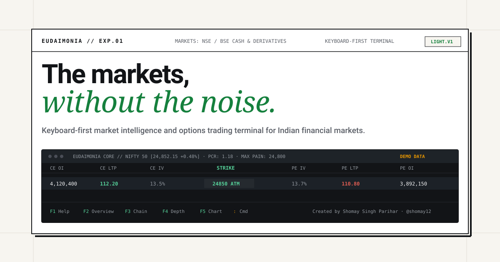

<div align="center">



# ⚡ EUDAIMONIA

### *The markets, without the noise.*

**Professional, Terminal-Native Market-Data & Options Analytics Terminal for Indian Markets (NSE / BSE)**

[](https://github.com/shomay12)
[](https://www.python.org/)
[](https://textual.textualize.io/)
[](https://www.nseindia.com/)
[](TESTING.md)
[](LICENSE)

[Key Features](#-key-features) •
[Terminal Showcase](#-terminal-interface-showcase) •
[Quickstart](#-quickstart-in-60-seconds) •
[Options Analytics & Greeks](#-mathematical-rigor--options-analytics) •
[Keyboard Shortcuts](#-keyboard-navigation-cheat-sheet) •
[Command Interface](#-interactive-command-line) •
[Architecture](#-system-architecture) •
[Docs](#-documentation-index)

---

</div>

## 📌 Introduction

**Eudaimonia** (Greek: *εὐδαιμονία*, human flourishing through reasoned excellence) is a high-performance, keyboard-driven market-data and quantitative derivatives analytics terminal engineered specifically for Indian equity and options traders.

Designed for traders who demand dense numerical clarity, sub-millisecond calculation pipelines, and predictable ergonomics, Eudaimonia eliminates web bloat, oversized decorative dashboards, marketing popups, and forced mouse navigation.

Built entirely with Python 3.11+, **Textual**, and **Rich**, it connects to Indian market feeds (National Stock Exchange & Bombay Stock Exchange) through a decoupled provider architecture supporting **Zerodha Kite Connect**, **Upstox V2**, and a deterministic **Mock Provider** generating correlated Brownian-walk tick simulation.

---

## 🚀 Key Features

```
┌────────────────────────────────────────────────────────────────────────────────────────┐
│  ⚡ Information Dense   ⚡ Keyboard Driven   ⚡ Real-Time Greeks   ⚡ Data Integrity    │
└────────────────────────────────────────────────────────────────────────────────────────┘
```

- **🖥️ True Terminal-Native Information Architecture**: Full-screen interactive monospaced interface. High-contrast numerical values, minimal borders, and zero mouse dependency.
- **🇮🇳 Comprehensive NSE & BSE Coverage**:
  - **Index Benchmarks**: NIFTY 50, BANKNIFTY, FINNIFTY, BSE SENSEX, BSE BANKEX.
  - **Cash Equities**: Reliance, TCS, Infosys, HDFC Bank, ICICI Bank, State Bank of India, Tata Motors, etc.
  - **F&O Derivatives Ladder**: Complete weekly and monthly Call (`CE`) and Put (`PE`) options contracts dynamically centered around At-The-Money (ATM).
- **📐 Mathematical Options Analytics & Greeks**:
  - Analytical Black-Scholes-Merton Greek calculations ($\Delta$, $\Gamma$, $\Theta$, $\mathcal{V}$, $\rho$).
  - High-precision Implied Volatility (IV) solver using **Brent's method** (`scipy.optimize.brentq`) with theoretical no-arbitrage boundary checks.
  - Put-Call Ratios (PCR) computed independently by **Open Interest** and **Volume**.
  - **Max Pain** strike determination minimizing aggregate option buyer payoff.
- **🕯️ Session-Aligned Candlestick & Volume Engine**:
  - Aggregates streaming ticks into **1m, 3m, 5m, 15m, and Daily** OHLCV bars.
  - Strictly aligned to Indian trading session boundaries (**09:15 to 15:30 IST**) in `Asia/Kolkata`.
  - Cumulative intraday **VWAP** (Volume-Weighted Average Price) calculation.
  - Interactive ASCII/Unicode candlestick charts with keyboard-based crosshair inspection (`←` and `→`).
- **🛡️ Data Quality & Anomaly Guardrails**:
  - Detects out-of-order exchange timestamps and sequence number gaps.
  - Flags duplicate ticks and non-positive suspect prices.
  - Real-time staleness monitoring with visual warning banners (`[FEED STALE]`).
- **🔌 Decoupled Market Data Provider Architecture**:
  - Abstract `BaseMarketDataProvider` contract.
  - Built-in **Mock Provider** (`DataMode.MOCK`) generating realistic correlated ticks, 5-depth books, and options chains without credentials.
  - Production **Zerodha Kite Connect** adapter (`DataMode.LIVE`).
  - Strict data-mode labelling: simulated or stale feeds are never misrepresented as live.
- **💾 Local SQLite Persistence**:
  - Asynchronous storage via `aiosqlite`.
  - Seamlessly persists custom watchlists, active underlying, preferred expiries, and terminal layout preferences.

---

## 🖥️ Terminal Interface Showcase

### 1. Market Overview & Watchlist Quotes (`F2`)
Dense overview of Indian benchmark indices with real-time net change, percentage delta, and 5-depth bid/ask quotes:

```text
EUDAIMONIA [KJshomay12]  NIFTY: 24,852.15 +45.20 (+0.18%)  BNIFTY: 52,310.00 -80.10 (-0.15%)  SENSEX: 81,620.00 +110.00 (+0.13%)
FEED: [MOCK] PROVIDER: MockIndianFeed STATE: CONNECTED SUBS: 14 LATENCY: 1.2ms | 14:32:05 IST
──────────────────────────────────────────────────────────────────────────────────────────────────────────────────────────
INDEX BENCHMARKS (NSE / BSE)
EXCHANGE  SYMBOL      NAME                   LTP         CHANGE   %CHG     HIGH        LOW         VOLUME
NSE       NIFTY       Nifty 50 Index         24,852.15   +45.20   +0.18%   24,890.50   24,810.00   150,000,000
NSE       BANKNIFTY   Nifty Bank Index       52,310.00   -80.10   -0.15%   52,450.00   52,220.00   95,000,000
BSE       SENSEX      BSE SENSEX Index       81,620.00  +110.00   +0.13%   81,750.00   81,510.00   120,000,000
BSE       BANKEX      BSE BANKEX Index       58,210.50   +35.00   +0.06%   58,340.00   58,100.00   45,000,000

ACTIVE WATCHLIST QUOTES (Press ENTER for Quote/Depth, 'c' for Chart, 'o' for Options Chain)
SYMBOL         LTP         CHANGE    %CHG      BID         ASK         SPREAD   VOLUME      STATUS
NSE:NIFTY      24,852.15   +45.20    +0.18%    24,852.10   24,852.20   0.10     150,000,000 OK
NSE:BANKNIFTY  52,310.00   -80.10    -0.15%    52,309.50   52,310.50   1.00     95,000,000  OK
NSE:RELIANCE    2,962.50   +12.50    +0.42%     2,962.00    2,963.00   1.00      1,240,500  OK
NSE:HDFCBANK    1,692.10    -4.20    -0.25%     1,692.00    1,692.20   0.20      2,150,000  OK
NSE:TCS         4,185.00   +25.00    +0.60%     4,184.50    4,185.50   1.00        620,000  OK
NSE:INFY        1,838.20    +8.20    +0.45%     1,838.00    1,838.40   0.40        980,000  OK
```

### 2. High-Density Options Chain Viewer (`F3`)
Real-time Call and Put ladder around the At-The-Money (ATM) strike, including analytical Greeks, PCR, and Max Pain:

```text
CHAIN: NIFTY SPOT: 24,852.15 EXPIRY: [30-OCT-2026] ATM: 24,850.00 MAX PAIN: 24,800.00 PCR (OI): 1.18 PCR (VOL): 1.05
Available Expiries: 30Oct | 06Nov | 13Nov | 27Nov | (Use '[' and ']' to change expiry, '-' and '+' for strikes)
──────────────────────────────────────────────────────────────────────────────────────────────────────────────────────────
CE OI       CE CHG   CE VOL    CE IV   DELTA  BID     ASK     CALL LTP   STRIKE    M   PUT LTP   BID     ASK     DELTA   PE IV   PE VOL    PE CHG   PE OI
1,250,000   +45,000  320,000   14.2%   0.72   210.50  211.20  210.80     24,700    ITM  45.20     45.00   45.50   -0.28   13.9%   180,000   -12,000  850,000
1,680,000   +95,000  510,000   13.8%   0.61   142.10  142.80  142.50     24,750    ITM  76.40     76.10   76.70   -0.39   13.5%   290,000   +18,000  1,120,000
2,450,000  +180,000  890,000   13.5%   0.50    88.20   88.90   88.50     24,800    ITM 122.10    121.80  122.40   -0.50   13.2%   480,000   +45,000  1,980,000
3,120,000  +320,000 1,450,000  13.1%   0.39    47.50   48.10   47.80  ▶ 24,850 ◀ ATM 181.50    181.10  181.90   -0.61   13.0%   720,000   +82,000  2,890,000
2,890,000  +210,000  980,000   13.4%   0.28    23.40   23.90   23.60     24,900    OTM 257.00    256.40  257.60   -0.72   13.3%   310,000   +24,000  1,450,000
```

### 3. Interactive Candlestick Chart with Volume & VWAP (`F5`)
Multi-timeframe OHLC candlestick rendering with interactive keyboard crosshair inspection:

```text
NSE:NIFTY [5m] TIME: 2026-10-29 14:15 O: 24,845.00 H: 24,865.20 L: 24,838.10 C: 24,852.15 CHG: +7.15 (+0.03%) VOL: 42,500 VWAP: 24,848.30
──────────────────────────────────────────────────────────────────────────────────────────────────────────────────────────
                                                  │       │       █       │  24,870.00
                                          █       █       █       │       █  24,860.00
                                  █       █       │       │       │       │  24,850.00
                          █       │       │                               │  24,840.00
                  █       │                                                  24,830.00
──────────────────────────────────────────────────────────────────────────┼ VOLUME
                                  ▄       █       ▅       █       ▃       █     55,000
```

### 4. Level-2 5-Depth Order Book (`F4`)
Real-time 5-level market depth with buyer/seller pressure metrics:

```text
SYMBOL: NSE:RELIANCE [Reliance Industries Ltd.]  EXCHANGE: NSE  SEGMENT: EQUITY  LOT: 250
LTP: 2,962.50  CHG: +12.50 (+0.42%)  LTQ: 250  SPREAD: 1.00  STATUS: OK
OPEN: 2,950.00  HIGH: 2,975.00  LOW: 2,945.00  PREV CLOSE: 2,950.00  TOTAL VOL: 1,240,500
──────────────────────────────────────────────────────────────────────────────────────────
BID DEPTH (BUY ORDERS)                     ASK DEPTH (SELL ORDERS)
ORDERS      QTY         BID PRICE          ASK PRICE   QTY         ORDERS
14          1,250       2,962.00           2,963.00    1,500       12
8             750       2,961.50           2,963.50    2,250       18
22          2,500       2,961.00           2,964.00    3,000       25
5             500       2,960.50           2,964.50    1,000        7
11          1,750       2,960.00           2,965.00    2,500       16
──────────────────────────────────────────────────────────────────────────────────────────
TOTAL       6,750                          10,250      TOTAL
```

---

## ⚡ Quickstart in 60 Seconds

### Step 1: Clone Repository
```bash
git clone https://github.com/KJshomay12/Eudaimonia.git
cd Eudaimonia
```

### Step 2: Set Up Virtual Environment
```bash
# Using standard Python
python3 -m venv .venv
source .venv/bin/activate  # On Windows: .venv\Scripts\activate

# Or using ultra-fast uv
uv venv --python python3.11 .venv
source .venv/bin/activate
```

### Step 3: Install Package
```bash
# Install core dependencies and editable binary
pip install -e .

# Or with uv
uv pip install -e .
```

### Step 4: Launch Eudaimonia
```bash
# Launch in default Mock mode (instant real-time simulation)
eudaimonia

# Or run directly via Python module
python -m eudaimonia.cli

# Launch targeting a specific underlying index or exchange
eudaimonia --underlying BANKNIFTY --exchange NSE
```

---

## ⌨️ Keyboard Navigation Cheat Sheet

Eudaimonia is engineered for zero mouse friction:

| Key Binding | Scope | Action |
| :--- | :--- | :--- |
| <kbd>F1</kbd> | Global | Open **Help & Command Reference Manual** |
| <kbd>F2</kbd> | Global | Switch to **Market Overview & Watchlist Screen** |
| <kbd>F3</kbd> | Global | Switch to **Options Chain Screen** |
| <kbd>F4</kbd> | Global | Switch to **Quote & 5-Depth Order Book Screen** |
| <kbd>F5</kbd> | Global | Switch to **Candlestick Chart Screen** |
| <kbd>F6</kbd> | Global | Switch to **Watchlists Management Screen** |
| <kbd>:</kbd> or <kbd>/</kbd> | Global | Open interactive **Command Line Prompt** |
| <kbd>ESC</kbd> | Global | Dismiss Command Line / Return to Overview Screen |
| <kbd>q</kbd> | Global | Quit Eudaimonia |
| <kbd>[</kbd> and <kbd>]</kbd> | Chain | Cycle to **Previous / Next Expiry Date** |
| <kbd>-</kbd> and <kbd>+</kbd> | Chain | **Shrink / Expand** visible strike range around ATM |
| <kbd>↑</kbd> and <kbd>↓</kbd> | Chain/Table | Scroll through rows in tables and ladders |
| <kbd>1</kbd>, <kbd>3</kbd>, <kbd>5</kbd> | Chart | Switch timeframe to **1m, 3m, or 5m** candles |
| <kbd>f</kbd>, <kbd>d</kbd> | Chart | Switch timeframe to **15m (f) or Daily (d)** candles |
| <kbd>v</kbd> | Chart | Toggle **VWAP** overlay on/off |
| <kbd>←</kbd> and <kbd>→</kbd> | Chart | Move **Crosshair Cursor** across historical candles |

---

## 💻 Interactive Command Line

Press <kbd>:</kbd> or <kbd>/</kbd> from any screen to open the bottom command prompt:

| Command | Arguments | Example | Description |
| :--- | :--- | :--- | :--- |
| `chain` | `[UNDERLYING]` | `chain NIFTY` | Open options chain for specified index or stock |
| `quote` | `<SYMBOL>` | `quote NSE:RELIANCE` | Open detailed quote and 5-depth order book |
| `chart` | `<SYM> [-i INT]` | `chart NSE:NIFTY -i 5m` | Open candlestick chart with timeframe |
| `watch` | `<SYMBOL>` | `watch NSE:TCS` | Add symbol to active watchlist |
| `unwatch` | `<SYMBOL>` | `unwatch NSE:TCS` | Remove symbol from active watchlist |
| `expiry` | `[DATE]` | `expiry` | Cycle to next available options contract expiry |
| `watchlist`| — | `watchlist` | Open watchlist management screen |
| `depth` | `<SYMBOL>` | `depth NSE:BANKNIFTY` | Inspect Level-2 order book depth |
| `greeks` | `[UNDERLYING]` | `greeks FINNIFTY` | Focus options chain on analytical Greeks |
| `status` | — | `status` | Display feed health, connection state, and latency |
| `help` | — | `help` | Display manual and keyboard reference |
| `quit` | — | `quit` | Gracefully exit application |

---

## 📐 Mathematical Rigor & Options Analytics

Eudaimonia calculates analytical derivatives metrics in real time:

### 1. Black-Scholes-Merton Pricing Formula
For European Options on NSE/BSE:

$$d_1 = \frac{\ln(S / K) + \left(r - q + \frac{1}{2}\sigma^2\right)T}{\sigma \sqrt{T}}, \quad d_2 = d_1 - \sigma \sqrt{T}$$

$$\text{Call Price} = S e^{-qT} N(d_1) - K e^{-rT} N(d_2)$$

$$\text{Put Price} = K e^{-rT} N(-d_2) - S e^{-qT} N(-d_1)$$

*Where $S$ is underlying spot, $K$ is strike, $T$ is time to expiry in years, $r$ is risk-free rate ($6.5\%$ for Indian 91-day T-bills), $q$ is continuous dividend yield, and $\sigma$ is volatility.*

### 2. Analytical Greeks Formulation
- **Delta ($\Delta$)**: Rate of change of option value with respect to underlying price:
  $$\Delta_{\text{Call}} = e^{-qT} N(d_1), \quad \Delta_{\text{Put}} = e^{-qT} [N(d_1) - 1]$$
- **Gamma ($\Gamma$)**: Rate of change of Delta per $1\text{ INR}$ change in underlying spot:
  $$\Gamma = \frac{e^{-qT} n(d_1)}{S \sigma \sqrt{T}}$$
- **Theta ($\Theta$)**: 1-calendar-day time decay in INR (annualized theta divided by $365$):
  $$\Theta_{\text{Call}} = \frac{1}{365} \left[ -\frac{S \sigma e^{-qT} n(d_1)}{2 \sqrt{T}} - r K e^{-rT} N(d_2) + q S e^{-qT} N(d_1) \right]$$
- **Vega ($\mathcal{V}$)**: Sensitivity to a $1\%$ ($0.01$) absolute shift in Implied Volatility:
  $$\mathcal{V} = \frac{S e^{-qT} \sqrt{T} n(d_1)}{100}$$
- **Rho ($\rho$)**: Sensitivity to a $1\%$ ($0.01$) change in risk-free interest rate:
  $$\rho_{\text{Call}} = \frac{K T e^{-rT} N(d_2)}{100}, \quad \rho_{\text{Put}} = -\frac{K T e^{-rT} N(-d_2)}{100}$$

### 3. Implied Volatility Solver
Eudaimonia solves for $\sigma$ such that:
$$C_{\text{market}} - C_{\text{BS}}(\sigma) = 0$$
Using **Brent's Method** (`scipy.optimize.brentq`), achieving quadratic convergence within $10^{-5}$ tolerance. Strict no-arbitrage boundary checks ($C \ge \max(0, S e^{-qT} - K e^{-rT})$) prevent numerical blowups on corrupted feeds.

### 4. Put-Call Ratio (PCR) & Max Pain
- **$\text{PCR}_{\text{OI}}$**: $\frac{\sum \text{Put Open Interest}}{\sum \text{Call Open Interest}}$
- **$\text{PCR}_{\text{Vol}}$**: $\frac{\sum \text{Put Volume}}{\sum \text{Call Volume}}$
- **Max Pain**: Evaluates total payout across all strikes to determine the price point at which option sellers incur minimum payout:
  $$\text{Loss}(S_i) = \sum_{K} \left[ \text{OI}_{\text{CE}}(K) \cdot \max(0, S_i - K) + \text{OI}_{\text{PE}}(K) \cdot \max(0, K - S_i) \right]$$
  $$\text{Max Pain Strike} = \arg\min_{S_i} \text{Loss}(S_i)$$

---

## 🏛️ System Architecture

```
Eudaimonia/
├── pyproject.toml              # Build metadata, dependencies & CLI entrypoints
├── .env.example                # Configuration template & credentials placeholders
├── README.md                   # Comprehensive project documentation
├── ARCHITECTURE.md             # System design, data pipeline & concurrency model
├── DATA_PROVIDER_SETUP.md      # Zerodha Kite Connect, Upstox & Mock setup
├── CONFIGURATION.md            # Environment variables & persistence reference
├── DATA_QUALITY.md             # Anomaly detection & sequence gap tracking
├── TESTING.md                  # Test suite guide & verification results
├── SECURITY_AND_DATA_RIGHTS.md # Regulatory boundaries & credential safety
├── eudaimonia/
│   ├── config.py               # Runtime settings & path management
│   ├── cli.py                  # Command-line entrypoint & argument parsing
│   ├── models/                 # Normalized market models (Tick, Depth, Greeks, Candle)
│   ├── analytics/              # Black-Scholes, Brent's IV solver, Greeks, Max Pain
│   ├── engine/                 # State engine, Candle engine (VWAP), Data Quality monitor
│   ├── providers/              # Base provider, Mock simulation, Zerodha Kite Connect
│   ├── storage/                # SQLite watchlists & preferences persistence (aiosqlite)
│   └── ui/                     # Textual app, Header, StatusFooter, Chart & Screens
└── tests/                      # 24 deterministic unit, analytical & headless tests
```

---

## 🔌 Connecting Live Broker Market Data

Eudaimonia supports live data feeds from Indian brokers while preserving complete separation between simulation and live modes.

### Zerodha Kite Connect
1. Copy `.env.example` to `.env`:
   ```bash
   cp .env.example .env
   ```
2. Populate your Kite Connect API credentials:
   ```bash
   EUDAIMONIA_PROVIDER=kite
   EUDAIMONIA_DATA_MODE=LIVE

   KITE_API_KEY=your_api_key_here
   KITE_API_SECRET=your_api_secret_here
   KITE_ACCESS_TOKEN=your_daily_access_token_here
   ```
3. Run:
   ```bash
   eudaimonia --provider kite --mode LIVE
   ```
   *For detailed daily TOTP token generation instructions, see [DATA_PROVIDER_SETUP.md](DATA_PROVIDER_SETUP.md).*

---

## 🧪 Automated Test Suite

Eudaimonia is tested with **24 deterministic unit and integration tests** verifying mathematical formulas, data quality triggers, and headless UI screen switching:

```bash
# Execute full test suite
pytest -v
```

```text
============================= test session starts ==============================
platform darwin -- Python 3.11.16, pytest-9.2.0, pluggy-1.7.0
rootdir: /Users/quaxiom/Documents/DEVLOPMENT/Projects/Eudaimonia

tests/test_analytics.py::test_put_call_parity PASSED                     [  4%]
tests/test_analytics.py::test_analytical_greeks_properties PASSED        [  8%]
tests/test_analytics.py::test_pcr_calculation PASSED                     [ 12%]
tests/test_analytics.py::test_atm_strike_finder PASSED                   [ 16%]
tests/test_analytics.py::test_moneyness_classification PASSED            [ 20%]
tests/test_analytics.py::test_max_pain_calculation PASSED                [ 25%]
tests/test_app_headless.py::test_eudaimonia_app_lifecycle PASSED         [ 29%]
tests/test_candle_engine.py::test_candle_aggregation_and_vwap PASSED     [ 33%]
tests/test_candle_engine.py::test_candle_engine_multi_timeframe PASSED   [ 37%]
tests/test_commands.py::test_cli_argument_parsing PASSED                 [ 41%]
tests/test_commands.py::test_command_line_known_commands PASSED          [ 45%]
tests/test_data_quality.py::test_non_positive_price_detection PASSED     [ 50%]
tests/test_data_quality.py::test_sequence_gap_and_duplicate_detection PASSED [ 54%]
tests/test_data_quality.py::test_out_of_order_timestamp_detection PASSED [ 58%]
tests/test_data_quality.py::test_staleness_detection PASSED              [ 62%]
tests/test_implied_vol.py::test_iv_solver_convergence PASSED             [ 66%]
tests/test_implied_vol.py::test_iv_solver_arbitrage_violation PASSED     [ 70%]
tests/test_instrument_master.py::test_instrument_master_indexing PASSED  [ 75%]
tests/test_mock_provider.py::test_mock_provider_lifecycle PASSED         [ 79%]
tests/test_models.py::test_instrument_model PASSED                       [ 83%]
tests/test_models.py::test_market_tick_calculations PASSED               [ 87%]
tests/test_models.py::test_market_depth_totals PASSED                    [ 91%]
tests/test_storage.py::test_watchlist_repository PASSED                  [ 95%]
tests/test_storage.py::test_preferences_repository PASSED                [100%]

============================== 24 passed in 2.80s ==============================
```

---

## ⚖️ Regulatory & Market Data Compliance

- **Personal Analytical Use**: Eudaimonia is designed solely for an individual trader's personal analytical workflows using their authenticated broker API access.
- **Redistribution Prohibition**: In accordance with SEBI, NSE, and BSE regulations, real-time market data obtained via retail broker APIs may **not** be rebroadcast, republished, or commercially redistributed without an official exchange vendor license.
- **Non-Execution Scope**: Initial versions intentionally omit automated order routing to eliminate accidental algorithmic trading liabilities under SEBI algorithmic trading circulars.

*See [SECURITY_AND_DATA_RIGHTS.md](SECURITY_AND_DATA_RIGHTS.md) for full compliance guidelines.*

---

## 📚 Documentation Index

- 📖 [ARCHITECTURE.md](ARCHITECTURE.md) — Comprehensive technical architecture, concurrency models, and state design.
- 🔌 [DATA_PROVIDER_SETUP.md](DATA_PROVIDER_SETUP.md) — Setup guide for Zerodha Kite, Upstox, and Mock feeds.
- ⚙️ [CONFIGURATION.md](CONFIGURATION.md) — Exhaustive environment variables and database reference.
- 🛡️ [DATA_QUALITY.md](DATA_QUALITY.md) — Feed verification, sequence tracking, and anomaly detection rules.
- 🧪 [TESTING.md](TESTING.md) — Test suite layout, coverage details, and execution guide.
- 🔒 [SECURITY_AND_DATA_RIGHTS.md](SECURITY_AND_DATA_RIGHTS.md) — Secret management and regulatory notice.

---

## 👤 Author & Maintainer

**Developed by**: `KJshomay12`  
**GitHub**: [@shomay12](https://github.com/shomay12)  
**Project**: Eudaimonia (Quaxiom Trade Terminal)  
**License**: MIT License

<div align="center">
<sub>Built with precision for Indian derivative and equity traders.</sub>
</div>
